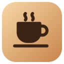
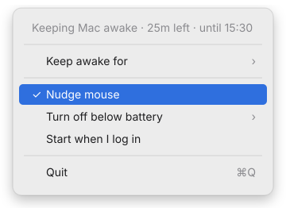

<p align="center">
  
</p>

<h1 align="center">CursorMov</h1>

<p align="center">
  <b>One click keeps your Mac awake, so your VPN and long-running jobs survive while you're away.</b>
</p>

<p align="center">
  <a href="https://metayoub.github.io/CursorMov/"><b>Website</b></a>
</p>

<p align="center">
  
  
  
  <a href="LICENSE"></a>
  <a href="https://github.com/metayoub/CursorMov/releases/latest"></a>
</p>

<p align="center">
  <br>
  <sub>Off: an empty cup</sub><br><br>
  <br>
  <sub>On: a full, steaming cup</sub>
</p>

---

## Why

You start a build, a migration, or a big download, and go grab a coffee. Twenty
minutes later the Mac has locked itself, the VPN has dropped, and the job is gone.

CursorMov is a tiny menu bar app that stops that from happening. Click the cup,
walk away, and your session is still there when you get back.

## Features

- **One click on, one click off.** Left-click the cup in the menu bar.
- **Keeps the Mac awake.** No idle sleep, no screen dimming, no auto-lock while it's on.
- **Mouse nudge (on by default).** When you've been away for a minute, it moves the
  pointer one pixel and straight back. You'll never see it, but macOS and apps that
  watch for activity register you as present.
- **Never gets in your way.** The nudge only happens while you're idle, never while
  you're using the mouse or keyboard.
- **Quiet.** No Dock icon, no window, no notifications. Just a cup.
- **Safe defaults.** It always starts switched off, and quitting releases everything.

## Using it

| Action | What happens |
| --- | --- |
| **Left-click** the cup | Turns keep-awake on or off |
| **Right-click** the cup (or Control-click) | Opens the menu |

<p align="center">
  
</p>

- **Keeping Mac awake · 1h 12m** shows how long it's been on.
- **Nudge mouse** turns the mouse nudge on or off. Your choice is remembered.
- **Start when I log in** adds CursorMov to your login items.
- **Quit** (⌘Q) stops CursorMov and lets your Mac sleep normally again.

## Install

### Download (easiest)

1. Download **CursorMov-1.0.0.dmg** from the
   [latest release](https://github.com/metayoub/CursorMov/releases/latest).
2. Open the DMG and drag **CursorMov** onto **Applications**.
3. Open CursorMov from Applications. The empty coffee cup appears in your menu bar.

> **"CursorMov can't be opened" / "Apple could not verify…"**
> CursorMov is free and open source, so it isn't signed with a paid Apple
> Developer ID. macOS blocks it the first time. To open it anyway:
> 1. Try to open CursorMov once, and close the warning.
> 2. Go to **System Settings → Privacy & Security**, scroll down, and click **Open Anyway** next to CursorMov.
> 3. Confirm with **Open**. You only need to do this once.
>
> Or, in Terminal: `xattr -dr com.apple.quarantine /Applications/CursorMov.app`

### Build from source

Requirements: macOS 26 or later, and Xcode 26 (or its command line tools with Swift 6.2).

```bash
git clone https://github.com/metayoub/CursorMov.git
cd CursorMov
scripts/build-app.sh
```

This builds `build/CursorMov.app`. Move it to your Applications folder:

```bash
mv build/CursorMov.app /Applications/
open /Applications/CursorMov.app
```

The empty coffee cup appears in your menu bar.

> **Updating?** Quit CursorMov and delete the old copy first:
> `rm -rf /Applications/CursorMov.app`

### Allow the mouse nudge

macOS only lets apps move the pointer if you allow it. The first time you turn
CursorMov on with **Nudge mouse** enabled, macOS asks for permission:

1. Click **Open System Settings** in the dialog.
2. In **Privacy & Security → Accessibility**, switch **CursorMov** on.

If you'd rather not grant it, that's fine. Keeping the Mac awake still works without
it, and only the nudge is skipped.

> If you rebuild the app, macOS may treat it as a new app. If the nudge stops working,
> remove CursorMov from the Accessibility list and add it again.

## How it works

- **Keep awake.** When on, CursorMov holds an IOKit power assertion
  (`PreventUserIdleDisplaySleep`). That stops the display and the system from idle
  sleeping, which also stops the idle screen lock. You can see it with
  `pmset -g assertions`.
- **Nudge.** Every 15 seconds it checks how long you've been idle. If it's been at least
  60 seconds, it posts a real mouse-moved event one pixel over and another one back.
  That resets macOS's idle timer just like a hand on the mouse would. If the pointer
  is parked in a screen corner, the nudge is skipped so it can't trigger a Hot Corner
  (such as Lock Screen); keep-awake still works there.

## Limitations

- **Keep the lid open.** macOS always sleeps a MacBook when the lid closes, and no
  regular app can prevent that.
- **VPN-side timeouts.** If your VPN server disconnects sessions with no traffic,
  keeping the Mac awake won't help with that.

## Development

```bash
swift test               # run the test suite
swift build              # debug build
scripts/build-app.sh     # build the .app bundle (Apple silicon + Intel)
CODESIGN_IDENTITY="Apple Development: you@example.com (TEAMID)" scripts/build-app.sh
                         # sign local builds so Accessibility permission survives rebuilds
scripts/build-dmg.sh     # build the release DMG into build/
swift scripts/make-icon.swift   # regenerate AppIcon.icns from AppIcon.svg
```

The project is a Swift package:

```
Sources/CursorMovCore/   core logic (testable) and macOS system adapters
Sources/CursorMov/       the menu bar app (AppKit)
Tests/CursorMovCoreTests/
Resources/Info.plist     app bundle settings (no Dock icon)
Resources/AppIcon.svg    app icon source (AppIcon.icns is generated from it)
scripts/                 build-app.sh, build-dmg.sh, make-icon.swift
```

## License

[MIT](LICENSE) © 2026 Ayoub Metwalli
