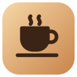
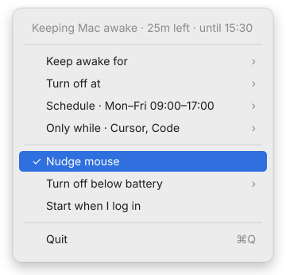

<p align="center">
  
</p>

<h1 align="center">CursorMov</h1>

<p align="center">
  <b>One click keeps your Mac awake, so your VPN and long-running jobs survive while you're away.</b>
</p>

<p align="center">
  <a href="https://metayoub.github.io/CursorMov/"><b>Website</b></a>
</p>

<p align="center">
  
  
  
  <a href="LICENSE"></a>
</p>

<p align="center">
  <br>
  <sub>One click: the cup fills up, and your Mac stays awake</sub>
</p>

<p align="center">
  <br>
  <sub>Off: an empty cup</sub><br><br>
  <br>
  <sub>On: a full, steaming cup</sub>
</p>

---

## Why

You start a build, a migration, or a big download, and go grab a coffee. Twenty
minutes later the Mac has locked itself, the VPN has dropped, and the job is gone.

CursorMov is a tiny menu bar app that stops that from happening. Click the cup,
walk away, and your session is still there when you get back.

**How it's different:** sleep blockers like Amphetamine, Caffeine and KeepingYouAwake
keep the Mac from sleeping. CursorMov does that too, and adds an idle-aware mouse nudge
that also keeps you looking active to apps that watch for user activity, and it never
touches your pointer while you're working.

## Features

- **One click on, one click off.** Left-click the cup in the menu bar.
- **Keeps the Mac awake.** No idle sleep, no screen dimming, no auto-lock while it's on.
- **Mouse nudge (on by default).** When you've been away for a minute, it moves the
  pointer one pixel and straight back. You'll never see it, but macOS and apps that
  watch for activity register you as present.
- **Never gets in your way.** The nudge only happens while you're idle, never while
  you're using the mouse or keyboard.
- **Timed sessions.** Keep awake for 15 minutes up to 4 hours, or until a time you pick (say 13:10), then it switches itself off.
- **Schedule.** Turns itself on and off at set times on the days you pick, say Mon–Fri 09:00–17:00.
- **Only while an app is open.** Stays on while Cursor, VS Code, or any app you pick is open, and turns off when the last one quits.
- **Battery safety.** On battery, it switches off when the charge drops to 20% (or 10%, 30%, or never).
- **Quiet.** No Dock icon, no window, no notifications. Just a cup.
- **Safe defaults.** It starts switched off (unless your schedule says otherwise), and quitting releases everything.

## Using it

| Action | What happens |
| --- | --- |
| **Left-click** the cup | Turns keep-awake on or off |
| **Right-click** the cup (or Control-click) | Opens the menu |

<p align="center">
  
</p>

- **The status line** shows how long it's been on (`Keeping Mac awake · 1h 12m`), or for a
  timed session how long is left and when it ends (`25m left · until 15:30`).
- **⚠︎ Allow mouse nudge in Accessibility…** appears when the nudge is on but macOS hasn't
  allowed it yet. Click it to open the right Settings page.

**Keep awake for**, **Turn off at**, **Schedule** and **Only while** are four ways to let
CursorMov switch itself on and off, and only one is in charge at a time: choosing one switches
the others off (your times, days and apps are kept for next time). The one in charge has a ✓.

- **Keep awake for** starts a timed session: 15 or 30 minutes, 1, 2 or 4 hours. It
  switches itself off when the time is up. Left-click still means "on until I click again".
- **Turn off at** does the same, but you pick the time it stops with the hour and minute
  arrows, then press **Start**. A time that has already passed today means tomorrow. It
  remembers the last time you picked.
- **Schedule** opens a submenu with an on/off switch, **From** and **To** times, and the
  days it repeats on. When it's on, CursorMov turns on at the From time and off at the
  To time, and the status line shows the next start (`Off · starts Mon 09:00`). If you
  turn it off during the scheduled time, it stays off until the next scheduled day. A To time
  earlier than the From time runs overnight. A session you start with a left-click is never
  cut short by the schedule.
- **Only while** opens a submenu with an on/off switch, the apps you've chosen (ticked, with
  an *open* badge when running), the apps open right now (click one to add it), and
  **Other app…** to pick one from Applications. While any chosen app is open, CursorMov
  stays on (`Keeping Mac awake · Cursor is open`); when the last one quits, it turns off.
  If you turn it off yourself while a chosen app is open, it stays off until you turn it on
  again. It sees whether an app is *open*, not what it's doing: an idle Cursor window still
  counts, and most VPN apps stay open when disconnected.
- **Nudge mouse** turns the mouse nudge on or off.
- **Turn off below battery** switches CursorMov off when your Mac is on battery and drops
  to the chosen level: Never, 10%, 20% (default) or 30%. The menu then shows
  `Off · battery dropped to 20%`. If you turn it on when the battery is already low, it
  respects your choice and stays on.
- **Start when I log in** adds CursorMov to your login items.
- **Quit** stops CursorMov and lets your Mac sleep normally again. While the menu is
  open, ⌘Q does the same.

Your choices for the nudge, the battery level, the schedule and the apps are remembered.

## Install

CursorMov isn't distributed as a download: you build it yourself from the source, which
takes about a minute.

### Build from source

Requirements: macOS 26 or later, and Xcode 26 (or its command line tools with Swift 6.2).

```bash
git clone https://github.com/metayoub/CursorMov.git
cd CursorMov
scripts/build-app.sh
```

This builds `build/CursorMov.app`. Move it to your Applications folder:

```bash
mv build/CursorMov.app /Applications/
open /Applications/CursorMov.app
```

The empty coffee cup appears in your menu bar.

> **Updating?** Quit CursorMov and delete the old copy first:
> `rm -rf /Applications/CursorMov.app`

### Allow the mouse nudge

macOS only lets apps move the pointer if you allow it. The first time you turn
CursorMov on with **Nudge mouse** enabled, macOS asks for permission:

1. Click **Open System Settings** in the dialog.
2. In **Privacy & Security → Accessibility**, switch **CursorMov** on.

If you'd rather not grant it, that's fine. Keeping the Mac awake still works without
it, and only the nudge is skipped.

> If you rebuild the app, macOS may treat it as a new app. If the nudge stops working,
> remove CursorMov from the Accessibility list and add it again.

## How it works

- **Keep awake.** When on, CursorMov holds an IOKit power assertion
  (`PreventUserIdleDisplaySleep`). That stops the display and the system from idle
  sleeping, which also stops the idle screen lock. You can see it with
  `pmset -g assertions`.
- **Nudge.** Every 15 seconds it checks how long you've been idle (and the timer and battery). If it's been at least
  60 seconds, it posts a real mouse-moved event one pixel over and another one back.
  That resets macOS's idle timer just like a hand on the mouse would. If the pointer
  is parked in a screen corner, the nudge is skipped so it can't trigger a Hot Corner
  (such as Lock Screen); keep-awake still works there.

## Limitations

- **Keep the lid open.** macOS always sleeps a MacBook when the lid closes, and no
  regular app can prevent that.
- **VPN-side timeouts.** If your VPN server disconnects sessions with no traffic,
  keeping the Mac awake won't help with that.

## Development

```bash
swift test               # run the test suite
swift build              # debug build
scripts/build-app.sh     # build the .app bundle (Apple silicon + Intel)
CODESIGN_IDENTITY="Apple Development: you@example.com (TEAMID)" scripts/build-app.sh
                         # sign local builds so Accessibility permission survives rebuilds
scripts/build-dmg.sh     # build the release DMG into build/
swift scripts/make-icon.swift   # regenerate AppIcon.icns from AppIcon.svg
```

The project is a Swift package:

```
Sources/CursorMovCore/   core logic (testable) and macOS system adapters
Sources/CursorMov/       the menu bar app (AppKit)
Tests/CursorMovCoreTests/
Resources/Info.plist     app bundle settings (no Dock icon)
Resources/AppIcon.svg    app icon source (AppIcon.icns is generated from it)
scripts/                 build-app.sh, build-dmg.sh, make-icon.swift
```

## License

[MIT](LICENSE) © 2026 Ayoub Metwalli

---

<p align="center">If CursorMov saves your session, a ⭐ helps others find it.</p>
